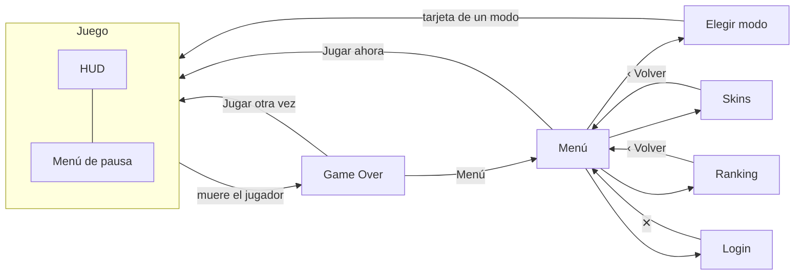

# Neon Snake

**Proyecto 8: Snake con skins** · Vue 3 + Phaser 3 + Pinia

| | |
| --- | --- |
| Integrantes | ________________________________________________ |
| | ________________________________________________ |
| | ________________________________________________ |
| Curso | ________________________________________________ |
| Fecha | ________________________________________________ |

---

## 1. Mapa de pantallas de Vue



| Pantalla | Dónde va cada cosa | Datos que cambian |
| --- | --- | --- |
| **Menú** (`/`) | Arriba a la izquierda "Jugando como …" y a la derecha "Iniciar sesión" o "Cerrar sesión". Al centro el título NEON SNAKE, el lema y el botón grande **Jugar ahora**. Debajo, en columna: **Elegir modo**, **Skins** (con la skin elegida en miniatura) y **Ranking**. | Nombre del jugador, skin elegida. |
| **Elegir modo** (`/modos`) | Arriba a la izquierda **‹ Volver** y el título. Debajo, una tarjeta por modo (nombre y descripción), sacadas de `modos.json`. | Ninguno (solo lee el JSON). |
| **Skins** (`/skins`) | Arriba **‹ Volver**, el título y "Tu récord: N puntos" (con sesión). Si juegas como invitado, debajo un aviso con el enlace "Inicia sesión". Debajo, una cuadrícula de tarjetas (1 columna en el celular, 3 en PC). Cada tarjeta: serpiente de vista previa, nombre, descripción y abajo el estado: **En uso**, botón **Usar** o 🔒 "Te faltan N puntos". | Skin elegida, skins desbloqueadas, récord. |
| **Ranking** (`/ranking`) | Arriba **‹ Volver** y el título. Debajo, una pestaña por modo y la tabla del top 10 (puesto, jugador, eliminados, puntos); tu fila aparte si no estás en el top. | Pestaña elegida, filas del servidor. |
| **Login** (`/login`) | Tarjeta centrada con **✕** arriba a la derecha, el título y el formulario (usuario, correo al crear cuenta y contraseña). | Sesión (token y usuario). |
| **Juego · HUD** (`/jugar/:modo`) | Barra de arriba. A la izquierda el puntaje: PUNTOS, ELIMINADOS, SERPIENTES (o TAMAÑO en Clásico), PUESTO (celular) y RÉCORD. A la derecha: sonido, **Pausa** y **Salir**. En PC, el ranking en vivo arriba a la derecha. Arriba al centro, el aviso "¡Nueva skin: Fuego!" y los mensajes ("X te eliminó"). En el celular: los mensajes abajo, la píldora "Puesto 3 de 8" a la derecha y la cruceta abajo a la izquierda. | Puntos, tamaño, eliminados, puesto, ranking en vivo, mensajes, aviso de skin. |
| **Juego · Pausa** | Tarjeta al centro: **Continuar**, sonido encendido/apagado, fila **Skin** con círculos de las skins desbloqueadas y **Salir al menú**. | Sonido, skin elegida (la serpiente cambia de color al instante). |
| **Game Over** | Tarjeta al centro: GAME OVER, el motivo ("Te eliminó X", "Chocaste contra el borde"), los puntos, el récord, la skin nueva con **Usarla**, el aviso de guardado, las estadísticas (tamaño, eliminados, tiempo, puesto) y abajo **Jugar otra vez**, **Ver ranking** y **Menú**. | Estadísticas de la partida, récord, skins nuevas. |

---

## 2. Mapa de escenas de Phaser

```
BootScene  ──►  GameScene  ──►  GameOverScene
(texturas)      (la partida)    (efecto final, encima de GameScene)
```

- **BootScene**: pinta una sola vez las texturas (círculo, brillo, cuadrícula y partícula) y arranca GameScene.
- **GameScene**: la partida, para todos los modos de `modos.json`. Al morir el jugador emite `snake-died`, se pausa y lanza GameOverScene encima.
- **GameOverScene**: el cuerpo explota, la cámara tiembla, la imagen se oscurece y a los 600 ms emite `game-over`.
- **Sin MenuScene**: el menú es una pantalla de Vue, así abre rápido en el celular y Phaser (~1 MB) solo se descarga al jugar.

**Área de juego** (64 × 40 celdas en el juego real):

```
┌────────────────────────────────────────────────────┐  ← borde: chocar = perder
│   ·          ·                    ●──●──●──◉ Cobra │     ·  comida (+10)
│        ·          ★                                │     ★  comida dorada (+50)
│                         ·                     ·    │     ◉  cabeza
│   ○──○──○──○──○──◎ Tú          ·                   │     ○◎ jugador (con su skin)
│                                                    │     ●  otro jugador (IA)
│        ·           ●                         ·     │
│                    ●──●──●──◉ Mamba          ★     │
│   ·                               ·                │
└────────────────────────────────────────────────────┘
```

**Tablero de 10 × 10** con una serpiente de 4 segmentos que va a la derecha (la cabeza es la última):

```
      x: 0  1  2  3  4  5  6  7  8  9
y: 0     .  .  .  .  .  .  .  .  .  .
   1     .  .  .  .  .  .  .  .  .  .
   2     .  .  .  .  .  .  .  .  .  .
   3     .  .  .  .  .  .  .  .  .  .
   4     .  .  .  .  .  .  .  ·  .  .     ·  comida en (7, 4)
   5     .  .  ○  ○  ○  ◎  .  .  .  .     ◎  cabeza en (5, 5)
   6     .  .  .  .  .  .  .  .  .  .
   7     .  .  .  .  .  .  .  .  .  .
   8     .  .  .  .  .  .  .  .  .  .
   9     .  .  .  .  .  .  .  .  .  .
```

```js
cells = [{x:2,y:5}, {x:3,y:5}, {x:4,y:5}, {x:5,y:5}]   // de la cola a la cabeza
dir   = {x:1, y:0}                                     // derecha
nextHead() = {x:6, y:5}                                // la celda a la que va
```

En cada paso se agrega la nueva cabeza al final y se quita la cola del principio (si comió, la cola no se quita y crece).

---

## 3. Tabla de eventos

Todos los nombres están en `src/events/names.ts`. Es el único puente entre Vue y Phaser.

| Evento | Lo emite | Lo escucha | Datos |
| --- | --- | --- | --- |
| `scene-ready` | Phaser (GameScene) | Vue (GameCanvas, GameView) | — |
| `render-lost` | Phaser (GameScene) | Vue (GameCanvas) | — |
| `score-changed` | Phaser (GameScene) | Vue (GameView → Pinia) | `{ score, length, botsKilled }` |
| `food-eaten` | Phaser (GameScene) | Vue (GameView: sonido) | `{ puntos, dorada, total }` |
| `bot-killed` | Phaser (GameScene) | Vue (GameView: sonido) | nombre del eliminado (texto) |
| `snake-died` | Phaser (GameScene) | Vue (GameView: sonido y Pinia) | `{ puntos, tamano, causa, eliminadoPor? }` |
| `game-over` | Phaser (GameOverScene) | Vue (GameView → Pinia) | `{ mode, score, length, botsKilled, foodsEaten, durationMs, killedBy, rank, players }` |
| `leaderboard` | Phaser (GameScene) | Vue (GameView → Pinia) | lista de `{ id, name, country, level, score, color, isPlayer }` |
| `feed` | Phaser (GameScene) | Vue (GameView → Pinia) | `{ text, mine }` |
| `pause` | Vue (GameView) | Phaser (GameScene) | — |
| `resume` | Vue (GameView) | Phaser (GameScene) | — |
| `turn` | Vue (GameView: cruceta) | Phaser (GameScene) | `'up' \| 'down' \| 'left' \| 'right'` |
| `skin-changed` | Vue (GameView) | Phaser (GameScene) | `{ id, colorCabeza, colorCuerpo, colorFranja, colorBrillo }` |

`causa` puede ser `'pared'`, `'cuerpo'` o `'jugador'` (y entonces lleva `eliminadoPor`).

---

## 4. Carpetas y datos

<table>
<tr>
<td valign="top">

```
client/src/
├── components/   (Vue)
│   ├── AvisoSkin.vue
│   ├── CapaJuego.vue
│   ├── GameCanvas.vue
│   ├── HudJuego.vue
│   ├── MenuPausa.vue
│   ├── PantallaGameOver.vue
│   └── SkinPreview.vue
├── views/        (Vue: pantallas)
│   ├── MenuView.vue
│   ├── ModesView.vue
│   ├── SkinsView.vue
│   ├── GameView.vue
│   ├── RankingView.vue
│   ├── LoginView.vue
│   └── NotFoundView.vue
├── scenes/       (Phaser)
│   ├── BootScene.ts
│   ├── GameScene.ts
│   └── GameOverScene.ts
├── game/         (entidades)
│   ├── Snake.ts
│   ├── bots/BotBrain.ts
│   ├── colors.ts
│   ├── constants.ts
│   └── config.ts …
├── stores/       (Pinia)
│   ├── game.ts
│   ├── skins.ts
│   ├── settings.ts
│   └── auth.ts
├── data/         (JSON)
│   ├── skins.json
│   ├── modos.json
│   ├── nombres.json
│   └── types.ts
├── events/       (eventos)
│   ├── EventBus.ts
│   └── names.ts
└── logic/        (reglas puras)
    └── skins.ts
```

</td>
<td valign="top">

```json
[
  {
    "id": "neon",
    "nombre": "Neón",
    "descripcion": "La clásica. Verde que brilla.",
    "colorCabeza": "#7dff5a",
    "colorCuerpo": "#39ff14",
    "colorFranja": "#22b80c",
    "colorBrillo": "#39ff14",
    "puntajeRequerido": 0
  },
  {
    "id": "hielo",
    "nombre": "Hielo",
    "descripcion": "Azul helado que corta el aire.",
    "colorCabeza": "#b8f3ff",
    "colorCuerpo": "#3ddcff",
    "colorFranja": "#1c8fb8",
    "colorBrillo": "#3ddcff",
    "puntajeRequerido": 100
  },
  {
    "id": "fuego",
    "nombre": "Fuego",
    "descripcion": "Naranja y rojo, como brasas encendidas.",
    "colorCabeza": "#ffd36b",
    "colorCuerpo": "#ff6a1a",
    "colorFranja": "#c4300c",
    "colorBrillo": "#ff4d1a",
    "puntajeRequerido": 500
  }
]
```

</td>
</tr>
</table>

---

## 5. Escalabilidad

Pasar de 6 a 20 skins, o de 2 a 10 modos, no cambia el código: solo se agregan elementos a `skins.json` o a `modos.json`. El selector de skins dibuja una tarjeta por cada skin del JSON, el store compara el puntaje con el `puntajeRequerido` de cada una y GameScene pinta lo que llega en `skin-changed`, sin saber cuántas skins existen. Con los modos pasa igual: Elegir modo y el Ranking hacen una tarjeta o pestaña por modo, la ruta `/jugar/:modo` acepta cualquier id del JSON y GameScene lee de ahí la comida, los jugadores y la velocidad. Las pruebas de `data.test.ts` avisan si a un elemento nuevo le falta un campo o repite un id.

| Se toca | No se toca |
| --- | --- |
| `src/data/skins.json` | `src/scenes/` (BootScene, GameScene, GameOverScene) |
| `src/data/modos.json` | `src/stores/` (game, skins, settings, auth) |
| | `src/views/` y `src/components/` (SkinsView, ModesView, HUD, pausa, Game Over) |
| | `src/events/` y `src/logic/` |

> Nota: el servidor guarda el ranking en línea solo de `arena` y `classic` (`server/src/services/ranking.ts`). Un modo nuevo se juega sin tocar el cliente, pero para que sus partidas entren al ranking en línea hay que agregar su id en esa lista del servidor.

---

## Las 3 pruebas rápidas de la guía

- ✔ **Puente**: Vue y Phaser solo se hablan por el EventBus con los nombres de `names.ts`; ninguna vista importa Phaser y ninguna escena toca el HTML.
- ✔ **Pinia**: el store solo guarda lo que se ve en pantalla (puntaje, récord, skins, ajustes); las posiciones de las serpientes y la comida viven solo dentro de GameScene.
- ✔ **JSON**: agregar una skin, un modo o un nombre de jugador es agregar un elemento a `skins.json`, `modos.json` o `nombres.json`, sin escribir código.

## Tabla "Pinia"

| Store | Dato | Tipo | Pantalla que lo muestra |
| --- | --- | --- | --- |
| game | `score` | número | HUD (PUNTOS) |
| game | `length` | número | HUD (TAMAÑO en Clásico) |
| game | `botsKilled` | número | HUD (ELIMINADOS) |
| game | `bestScore` | número | HUD (RÉCORD) y Game Over |
| game | `newRecord` | sí / no | Game Over ("¡Nuevo récord!") |
| game | `leaderboard` | lista | Juego (ranking en vivo y píldora del puesto) |
| game | `feed` | lista | Juego (mensajes "X te eliminó") |
| game | `muerte` | objeto | Game Over (motivo) |
| game | `gameOver` | objeto | Game Over (estadísticas) |
| game | `mode` | texto | Juego (récord de ese modo) |
| skins | `elegida` | texto | Menú (miniatura), Skins (En uso) y Pausa |
| skins | `desbloqueadas` | lista | Skins (Usar / bloqueada) y Pausa (círculos) |
| skins | `nuevas` | lista | Juego (aviso) y Game Over (Usarla) |
| skins | `recordCuenta` | número | Skins ("Tu récord" y lo que falta) |
| settings | `muted` | sí / no | HUD y Pausa (sonido) |
| auth | `user` | objeto | Menú ("Jugando como …") |
| auth | `token` | texto | No se muestra: es la sesión para guardar la partida en el servidor |

## Flujo del desbloqueo

Las skins se desbloquean solo con sesión iniciada y quedan en la cuenta: al entrar, Pinia pide al servidor la mejor partida de la cuenta (la misma del ranking) y desbloquea lo que alcance. Los invitados solo tienen la primera skin.

1. Phaser (GameScene) emite `score-changed` cada vez que cambia el puntaje.
2. GameView lo escucha, actualiza `useGameStore` y llama a `skins.comprobar(puntaje)`.
3. Si hay sesión, Pinia compara el puntaje con el `puntajeRequerido` de cada skin del JSON. Si alcanza una nueva, la agrega a `desbloqueadas` y a `nuevas`. Si es invitado, no desbloquea nada.
4. Vue muestra un aviso pequeño durante la partida: "¡Nueva skin: Fuego!" (2,5 s, arriba al centro, sin tapar el juego en el celular). En el Game Over aparece de nuevo con un botón "Usarla".

Pinia no guarda nada que no se muestre: `elegida` y `desbloqueadas` las muestra el selector de skins; `nuevas`, el aviso y el Game Over.
